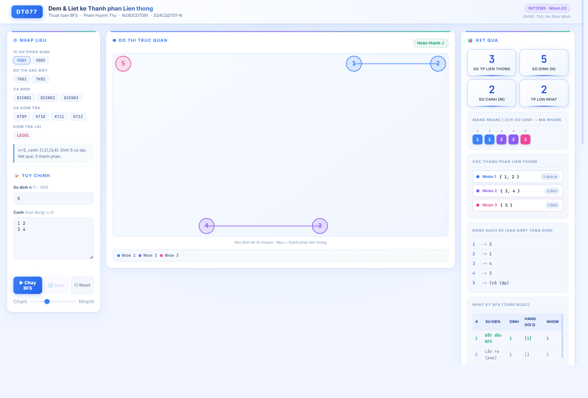
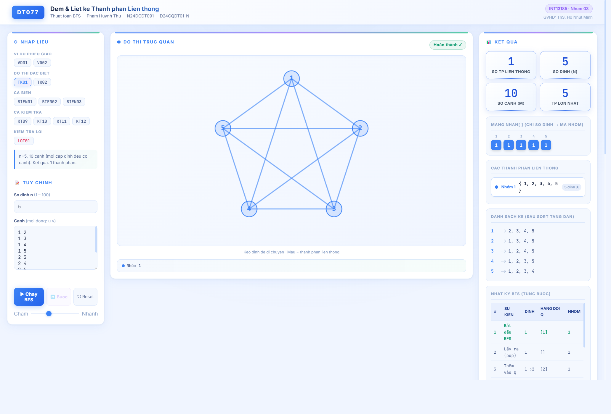
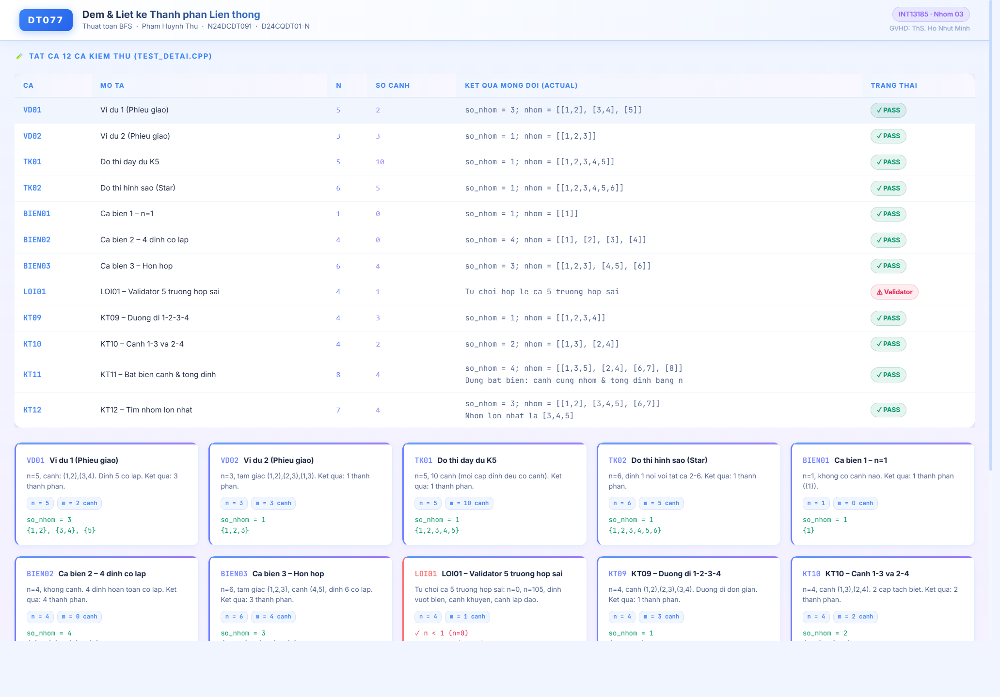

# DT077 — ĐẾM VÀ LIỆT KÊ CÁC THÀNH PHẦN LIÊN THÔNG (BẰNG BFS)

Học phần: **Cấu trúc Dữ liệu và Giải thuật (INT13185)** — Nhóm 03  
Học viện Công nghệ Bưu chính Viễn thông (PTIT)  
Giảng viên hướng dẫn: **ThS. Hồ Nhựt Minh**  
Sinh viên thực hiện: **Phạm Huỳnh Thư** — MSSV: **N24DCDT091** — Lớp: **D24CQDT01-N**  

---

## 📌 1. Giới thiệu Đề tài
Đề tài **DT077** yêu cầu xây dựng chương trình phân rã một đồ thị vô hướng $G = (V, E)$ gồm $n$ đỉnh ($1 \le n \le 100$) thành các thành phần liên thông rời nhau sử dụng thuật toán tìm kiếm theo chiều rộng (**BFS - Breadth-First Search**).
- Duyệt vòng ngoài từ đỉnh $1 \to n$, gặp đỉnh chưa gán nhóm thì khởi động BFS từ đỉnh đó.
- Sử dụng hàng đợi FIFO (`std::queue`) để lan truyền và gán chung một mã nhóm cho toàn bộ các đỉnh thuộc cùng một thành phần liên thông.
- Xử lý hoàn hảo các đỉnh cô lập (không có cạnh nối), đồ thị đầy đủ ($K_n$), đồ thị hình sao, đồ thị nhiều cụm rời nhau.
- Tính năng mở rộng: Tự động tìm và chỉ ra thành phần liên thông có kích thước lớn nhất.

---

## 📁 2. Cấu trúc Kho Mã nguồn
```
tieuluancuoiky/
├── DT077_CPP/                          # Mã nguồn C++ chính thức của đồ án
│   ├── include/DeTai.h                 # Khai báo cấu trúc dữ liệu, prototype hàm
│   ├── src/DeTai.cpp                   # Cài đặt BFS, danh sách kề, validator kiểm tra hợp đồng
│   ├── demo.cpp                        # Minh họa 2 ví dụ phiếu giao và các ca kiểm tra
│   ├── test_detai.cpp                  # Bộ kiểm thử tự động 12 ca kiểm độc lập (50 assertions)
│   ├── docs/anh_ket_qua/               # Thư mục lưu trữ 11 ảnh minh chứng thực tế (A01 - A11)
│   ├── build_and_run.bat               # Script biên dịch và chạy tự động C++
│   └── README.md                       # Hướng dẫn chi tiết biên dịch C++
├── web_app/                            # Ứng dụng Web trực quan hóa tương tác
│   ├── index.html                      # Cấu trúc giao diện Web Demo
│   ├── app.js                          # Thuật toán BFS, Force-directed Graph, Animation từng bước
│   ├── style.css                       # Giao diện hiện đại (White × Sky Blue × Lavender)
│   └── screenshots/                    # Ảnh chụp thực tế các ca kiểm thử từ Web App
├── chay_web_local.bat                  # Script khởi động nhanh Web Server cục bộ (port 8000)
├── .gitignore                          # Quy tắc loại trừ tệp tạm, nhị phân biên dịch
└── README.md                           # Tài liệu tổng quan kho lưu trữ
```

---

## 🚀 3. Hướng dẫn Biên dịch & Chạy

### 3.1. Chạy Mã nguồn C++ (MinGW g++)
Mở terminal tại thư mục `DT077_CPP/`:
```powershell
# Biên dịch chương trình demo
g++ -std=c++11 -Wall -O2 src/DeTai.cpp demo.cpp -o demo.exe
.\demo.exe

# Biên dịch và chạy bộ kiểm thử tự động (12 ca kiểm)
g++ -std=c++11 -Wall -O2 src/DeTai.cpp test_detai.cpp -o test_detai.exe
.\test_detai.exe
```
Hoặc chạy trực tiếp script:
```powershell
.\build_and_run.bat
```

### 3.2. Chạy Ứng dụng Web Trực quan hóa (Interactive Web Visualizer)
Từ thư mục gốc dự án:
- **Cách 1:** Nhấp đúp vào file `chay_web_local.bat`.
- **Cách 2:** Khởi chạy bằng Python HTTP server:
```powershell
python -m http.server 8000 --directory web_app
```
Truy cập trình duyệt tại địa chỉ: **`http://localhost:8000`**

---

## 🧪 4. Kết quả Kiểm thử Tự động (12/12 Ca Đạt 100% PASS)

| Mã ca | Loại ca | Đầu vào $(n, m)$ | Kết quả mong đợi | Trạng thái |
| :---: | :--- | :--- | :--- | :---: |
| **VD01** | Ví dụ phiếu 1 | $n=5, m=2$: Cạnh $(1,2), (3,4)$ | 3 nhóm: $\{1,2\}, \{3,4\}, \{5\}$ | **PASS** |
| **VD02** | Ví dụ phiếu 2 | $n=3, m=3$: Tam giác $(1,2), (2,3), (1,3)$ | 1 nhóm: $\{1,2,3\}$ | **PASS** |
| **TK01** | Tự thiết kế 1 | $n=5, m=10$: Đồ thị đầy đủ $K_5$ | 1 nhóm: $\{1,2,3,4,5\}$ | **PASS** |
| **TK02** | Tự thiết kế 2 | $n=6, m=5$: Đồ thị hình sao tâm 1 | 1 nhóm: $\{1,2,3,4,5,6\}$ | **PASS** |
| **BIEN01** | Ca biên 1 | $n=1, m=0$: Đồ thị 1 đỉnh cô lập | 1 nhóm: $\{1\}$ | **PASS** |
| **BIEN02** | Ca biên 2 | $n=4, m=0$: 4 đỉnh đều cô lập | 4 nhóm: $\{1\}, \{2\}, \{3\}, \{4\}$ | **PASS** |
| **BIEN03** | Ca biên 3 | $n=6, m=4$: Tam giác + cạnh rời + đỉnh cô lập | 3 nhóm: $\{1,2,3\}, \{4,5\}, \{6\}$ | **PASS** |
| **LOI01** | Ca lỗi (Validator) | 5 ca sai hợp đồng ($n<1, n>100$, đỉnh ngoài miền, cạnh khuyên, cạnh lặp) | Từ chối hợp lệ cả 5 ca | **PASS** |
| **KT09** | Ca kiểm tra 9 | $n=4, m=3$: Đường đi $1-2-3-4$ | 1 nhóm: $\{1,2,3,4\}$ | **PASS** |
| **KT10** | Ca kiểm tra 10 | $n=4, m=2$: Cặp cạnh độc lập $(1,3)$ và $(2,4)$ | 2 nhóm: $\{1,3\}, \{2,4\}$ | **PASS** |
| **KT11** | Ca kiểm tra 11 | $n=8, m=4$: Kiểm chứng bất biến tổng số đỉnh $\sum \|C_i\| = n$ | Bất biến toán học thỏa mãn | **PASS** |
| **KT12** | Ca kiểm tra 12 | $n=7, m=4$: Tính năng mở rộng tìm nhóm lớn nhất | Nhóm lớn nhất: $\{3,4,5\}$ (size 3) | **PASS** |

---

## 🖼️ 5. Hình ảnh Minh chứng Thực tế từ Ứng dụng Web

### Ví dụ 1 (VD01 — n=5, 3 thành phần liên thông)


### Ca tự thiết kế 1 (TK01 — Đồ thị đầy đủ K5)


### Bảng Tổng kết 12 Ca Kiểm thử trên Giao diện Web


---

## 📜 6. Cam kết Tác quyền
Toàn bộ mã nguồn C++, bộ kiểm thử tự động, giao diện web visualizer và báo cáo đồ án được sinh viên **Phạm Huỳnh Thư (MSSV: N24DCDT091)** tự xây dựng, biên dịch và kiểm nghiệm thực tế theo đúng yêu cầu đề tài **DT077** của học phần **INT13185**.
